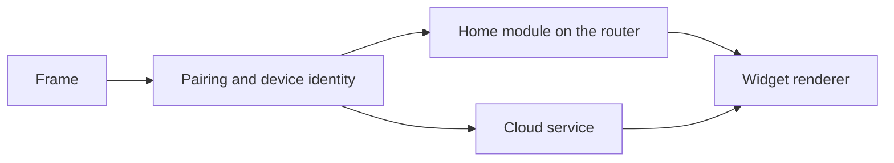
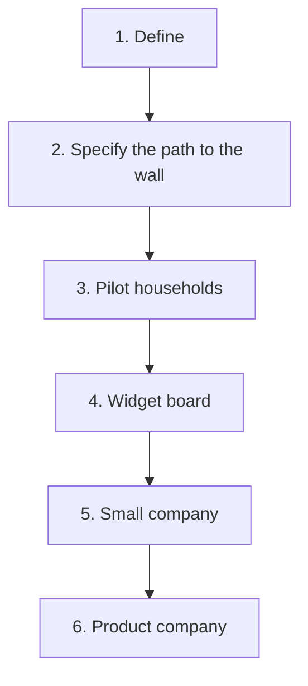

# Commercial plan

**End state.** A person pays, receives a frame, connects it, chooses
what it shows, and hangs it. Home frame buyers plug a module into their
router. Cloud frame buyers sign in to an account. Nobody solders, flashes
a Pico, or runs a Rust server by hand.

This page is the only high-level plan. Each stage ends with a gate: a
short list of things that must be true before the next stage starts.
The briefs in this folder own the detail.

## Where we are (October 2026)

- One working frame in one kitchen. Built from retail parts
  ([`shopping.md`](../shopping.md)): Pimoroni Inky Impression 13.3″,
  Pico LiPo 2 XL W, a Pico-to-Pi HAT, a 10 000 mAh pouch, an IKEA frame.
  Assembly needs soldering and a polarity check on the battery.
- A Rust server on the LAN fetches household data, renders HTML with
  Chromium, dithers to Spectra 6, and answers the frame
  ([`docs/setup.md`](../docs/setup.md)).
- Wi-Fi and server address are typed into the Pico over USB serial.
  Firmware updates need a computer and the BOOTSEL button.
- The family UI has no authentication. It trusts the LAN.
- The dashboard is a fixed 1600×1200 grid built around one household:
  London Tube, a Wandsworth bin UPRN, Pronote, French saints, Meross,
  Minecraft minutes.
- Server GPL-3.0, firmware AGPL-3.0-or-later. Public on GitHub.

## Two products

| | Cloud frame | Home frame |
|---|---|---|
| Hardware | Frame | Frame + home module |
| Rendering | Family Frame servers | Module on the router |
| Data | Leaves the house | Stays on the LAN |
| Strength | Simplest setup, no extra box | Privacy, works without our servers |
| Main cost | Running a service for every frame, for years | A second device to build and certify |

Details: [`offer.md`](offer.md).

## Sequence

**Home frame first, cloud designed in from the start.**

The home module is the current server packaged as an appliance. That is
the shortest road from a working prototype to a household that is not
ours. It also keeps the first buyers’ calendars and school data off our
servers while we are small.

Three choices are made early so the Cloud frame follows without a second
frame design:

1. The frame finds its server by a pairing step and a stored address,
   never a hard-coded LAN IP. The same frame can point at a module or at
   the cloud.
2. The frame speaks TLS and holds a per-device identity, even when the
   server is a module on the LAN.
3. Widget and layout settings live in a format that can be stored per
   household on a server, not only in a single `config.toml`.

The renderer is one codebase. The module runs one household; the cloud
runs many. See [`platform.md`](platform.md).

## Stages

Stages 3 and 4 can overlap: engineering on widgets starts while pilot
units are in kitchens. Every other gate is strict.

### 1. Define

Write down what is being sold and what is not.

**Gate**

- [ ] Both products described in [`offer.md`](offer.md), including what
      is in each box.
- [ ] Widget direction agreed in [`widgets.md`](widgets.md).
- [ ] Licence questions listed in [`licensing.md`](licensing.md) and
      parked with a date to revisit before Stage 5.
- [ ] Repository visibility decided for Stage 3 (public, or the
      commercial briefs moved somewhere private).
- [ ] Compliance obligations for selling even a handful of units listed
      in [`certification.md`](certification.md).

### 2. Specify the path to the wall

Make the buyer journey concrete enough that engineering can build it
without guessing.

**Gate**

- [ ] Unbox-to-wall journey for the Home frame written step by step in
      [`experience.md`](experience.md), including every failure the
      buyer can hit.
- [ ] Pairing, device identity, and TLS designed in
      [`platform.md`](platform.md) for both products.
- [ ] Home-module hardware chosen and costed in
      [`hardware.md`](hardware.md).
- [ ] Privacy promises for the Home frame written in
      [`privacy.md`](privacy.md).
- [ ] Third-party data sources checked for commercial use; anything
      unlicensed has a replacement or is dropped
      ([`widgets.md`](widgets.md)).

### 3. Pilot households (tens of units)

Ten to thirty Home frames in kitchens that are not ours. People pay,
or units are lent under a written pilot agreement. The fixed dashboard
is acceptable here.

**Gate**

- [ ] A buyer sets up the frame and module without us in the room, from
      the box insert alone.
- [ ] Wi-Fi onboarding works without a USB serial terminal.
- [ ] Frame firmware and module software update without a computer.
- [ ] Family UI requires authentication; no default shared passwords.
- [ ] No customer soldering. Battery arrives fitted and polarity-safe.
- [ ] The compliance file required for the units we hand over exists
      ([`certification.md`](certification.md)).
- [ ] Terms of sale, returns, and a warranty promise exist
      ([`company.md`](company.md)).
- [ ] Measured battery life across pilot homes supports whatever claim
      we make in [`offer.md`](offer.md).
- [ ] Support log shows what broke and how often
      ([`support.md`](support.md)).

### 4. Widget board

The household chooses widgets and arranges them. UK- and France-specific
sources become optional packs. Required before marketing to households
that do not look like the original one.

**Gate**

- [ ] A household builds its own layout in the family UI and sees it on
      the glass without editing HTML or TOML.
- [ ] Core widgets work with no country assumptions (calendar, weather,
      to-dos, photos, birthdays, countdowns, notes).
- [ ] At least one country pack each for the UK and France.
- [ ] Interface and widget text translatable; English and French
      shipped.
- [ ] Every widget that calls a third party has terms that allow our
      use ([`widgets.md`](widgets.md)).

### 5. Small company (low hundreds of units a year)

A company sells both products to the public.

**Gate**

- [ ] Company formed, insured, and registered for the obligations in
      [`company.md`](company.md).
- [ ] Licence decision made and acted on
      ([`licensing.md`](licensing.md)).
- [ ] Both products certified for every country we ship to
      ([`certification.md`](certification.md)).
- [ ] Cloud frame live: accounts, multi-household rendering, deletion,
      a published support period ([`platform.md`](platform.md),
      [`privacy.md`](privacy.md)).
- [ ] Repeatable assembly with a written test step; spares on the shelf
      ([`supply.md`](supply.md)).
- [ ] Price covers parts, assembly, shipping, returns, payment fees, and
      years of cloud running cost ([`pricing.md`](pricing.md)).
- [ ] Support runs without the founder answering every message
      ([`support.md`](support.md)).
- [ ] Shop, payments, and fulfilment in place
      ([`go-to-market.md`](go-to-market.md)).

### 6. Product company

Volume high enough that retail parts and hand assembly stop making
sense.

**Gate** (written later; listed here so earlier stages do not block it)

- [ ] Custom frame board replaces the Pico, HAT, and headers.
- [ ] Panel bought from the panel maker or a distributor at volume.
- [ ] Contract manufacturer with incoming and end-of-line tests.
- [ ] Country packs beyond the UK and France.
- [ ] Retail or marketplace channels alongside direct sales.

## Who owns what

| Area | Brief | First stage that needs it |
|---|---|---|
| What is sold | [`offer.md`](offer.md) | 1 |
| Buyer journey | [`experience.md`](experience.md) | 2 |
| Widgets and layout | [`widgets.md`](widgets.md) | 1 (direction), 4 (built) |
| Software platform | [`platform.md`](platform.md) | 2 |
| Hardware | [`hardware.md`](hardware.md) | 2 |
| Privacy | [`privacy.md`](privacy.md) | 2 |
| Licence | [`licensing.md`](licensing.md) | 1 (parked), 5 (decided) |
| Company and consumer law | [`company.md`](company.md) | 3 |
| Certification | [`certification.md`](certification.md) | 1 (listed), 3 (minimum file), 5 (full) |
| Supply and assembly | [`supply.md`](supply.md) | 3 |
| Pricing | [`pricing.md`](pricing.md) | 3 |
| Go-to-market | [`go-to-market.md`](go-to-market.md) | 3 |
| Support | [`support.md`](support.md) | 3 |

## Biggest risks

| Risk | Why it matters | Brief |
|---|---|---|
| No legal small-batch shortcut | Selling even ten radio devices with lithium cells carries product-safety, radio, battery, and security duties | [`certification.md`](certification.md) |
| Single panel supplier | The 13.3″ Spectra 6 panel is the most expensive part and comes from one maker | [`hardware.md`](hardware.md) |
| Unofficial data sources | Pronote, Meross, and BBC Weather are used without a commercial agreement | [`widgets.md`](widgets.md) |
| Cloud running cost | Chromium per render, for every frame, for as long as we promise support | [`platform.md`](platform.md), [`pricing.md`](pricing.md) |
| Battery claim | “Six months on a charge” is a marketing claim that must be backed by measurements | [`offer.md`](offer.md) |
| AGPL firmware | The panel driver is a port of AGPL code; going private does not remove that | [`licensing.md`](licensing.md) |
