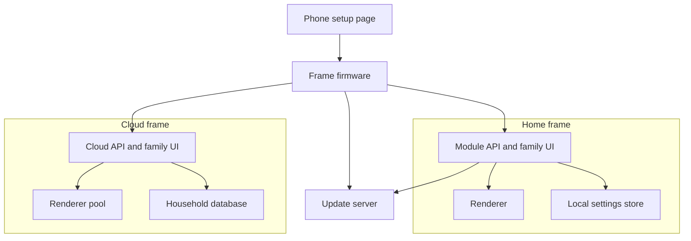

# Platform

The software that turns today’s LAN server and USB-provisioned Pico into
two products: a home module appliance and a multi-household cloud.

Plan stages: designed in **2**, home module in **3**, cloud in **5**.
See [`plan.md`](plan.md).

## Where we are

| Piece | Today | Why it blocks selling |
|---|---|---|
| Frame provisioning | USB serial: `wifi`, `psk`, `server`, `save` ([`firmware/README.md`](../firmware/README.md)) | Buyers do not have a serial terminal |
| Frame firmware updates | UF2 drag-and-drop with BOOTSEL | Needs a computer and opening the frame |
| Frame ↔ server | Plain HTTP to `host:port`, no identity ([`firmware/PROTOCOL.md`](../firmware/PROTOCOL.md)) | Anyone on the LAN can impersonate either side; cannot cross the internet safely |
| Family UI | No authentication; trusted LAN ([`docs/setup.md`](../docs/setup.md)) | Connected-product security rules; `GET /api/settings` returns the Todoist token |
| Settings | One `config.toml` written by the UI | One household per process; no history; cloud needs per-household storage |
| Secrets | Plain text in `config.toml`, `meross-creds.json` | Fine on a personal machine; not in a product or a cloud |
| Rendering | Minijinja HTML → Chromium screenshot → Floyd–Steinberg → 960 000-byte `.bin` | Chromium sets the module’s minimum hardware and the cloud’s cost |
| Packaging | Docker image on Docker Hub, amd64 and arm64, `VERSION` file drives tags | Good base for the module; not yet an appliance |
| Telemetry | `/stats` battery graph and poll log per frame | Good base for support and fleet health |

The frame is already a dumb client: it never sees calendars or HTML. That
is the right split for both products.

## Decided

- **2026-10-10** Home module first; the frame protocol, identity, and
  settings store are designed so the cloud reuses them
  ([`plan.md`](plan.md)).

## Architecture

One renderer codebase, run as a single household on the module and as a
pool in the cloud.

## Work areas

### 1. Wi-Fi onboarding on the frame

The CYW43439 radio on the Pico LiPo 2 XL W supports Wi-Fi and Bluetooth
LE.

| Option | For | Against |
|---|---|---|
| Bluetooth LE from a web page | Smooth; frame stays off Wi-Fi until configured | Web Bluetooth does not work in iOS Safari; iPhone users need an app |
| Temporary frame hotspot with a captive page | No app; works on every phone | Clunkier: phone leaves home Wi-Fi during setup |
| Native app with BLE | Best experience | An app to build and maintain on two stores |

Recommendation to test in Stage 2: hotspot first (works everywhere),
BLE when a native app exists. Either way the setup screen must say the
network has to be 2.4 GHz.

### 2. Pairing and device identity

- Each frame gets a unique key pair at the factory or on first boot,
  plus a printed pairing code on the card.
- **Home frame:** the module shows the code it expects; the frame and
  module pin each other’s public keys at pairing. The module address is
  found by mDNS (`family-frame.local`) and stored.
- **Cloud frame:** the pairing code claims the frame for a household
  account.
- Factory reset wipes keys, Wi-Fi, and ownership.

### 3. Transport security

The frame talks TLS to both the module and the cloud. On the LAN, the
module certificate is self-signed and pinned at pairing. The RP2350 has
a hardware random generator and SHA-256 acceleration; PSRAM gives room
for TLS buffers. Measure the extra wake time and battery cost before
committing.

### 4. Frame firmware updates

The RP2350 boot ROM supports partitioned flash with A/B images and
“try before you buy” boot, plus signed images with secure boot. A failed
update falls back to the last good image.

Secure boot interacts with the GPL v3 “installation information” clause
for consumer devices. Resolve with [`licensing.md`](licensing.md) before
locking any keys.

### 5. Home module appliance

- Base OS: a minimal Linux image with a read-only root and an A/B
  update scheme, or the existing Docker image on a managed host OS.
- First-run setup page served by the module; owner account with a
  password; no shared default credentials.
- Local name via mDNS; works without internet apart from the household’s
  own data sources and update checks.
- Backups: export and import household settings and photos.
- Watchdog: restart Chromium and the server if a render hangs.

### 6. Renderer and Chromium

Chromium needs roughly a Raspberry Pi 4 or 5 class board with 2–4 GB of
RAM. That fixes the module’s cost floor ([`hardware.md`](hardware.md)).

| Option | Module | Cloud | Cost of change |
|---|---|---|---|
| Keep Chromium | Pi 4/5 class | One headless browser pool | None; current pipeline |
| Native renderer (layout and text in Rust, no browser) | Smaller, cheaper boards | Cheaper per render | Rewrite templates; browser preview must still match the glass |

Render volume is small: a frame wakes a handful of times a day, and every
wake re-renders. A thousand frames at five wakes is about five thousand
renders a day. Cost is dominated by running the service at all, not by
render volume. Keep Chromium until Stage 5 numbers say otherwise.

### 7. Settings and secrets

- Replace `config.toml` as the source of truth with a store that holds
  one household (module) or many (cloud): SQLite on the module, a managed
  database in the cloud.
- Widget settings follow the schema in [`widgets.md`](widgets.md).
- Secrets (calendar links with private tokens, Todoist, smart-home
  logins) encrypted at rest; never returned by read APIs.
- Third-party logins move to OAuth wherever the provider offers it.

### 8. Family UI authentication

Owner and member accounts, sessions, and rate-limited login on both
products. The Minecraft and Siri endpoints keep working with per-
household API tokens.

### 9. Cloud service (Stage 5)

- Accounts, households, frames, memberships.
- Renderer workers with per-household isolation.
- Photo storage with deletion that actually deletes.
- Status page, monitoring, on-call rota sized to the business.
- Region choice for data residency (UK and EU households).

### 10. Fleet health and support tooling

Extend `/stats` into a support view: last contact, battery trend, failed
wakes, firmware version. For the Home frame, only with the owner’s
consent ([`privacy.md`](privacy.md)).

## Open questions

1. Hotspot, BLE, or app for onboarding? (See work area 1.)
2. Module OS and update mechanism: build our own image, or use a managed
   fleet platform?
3. Does the module accept remote access through us (a relay), or is that
   left to the household’s own VPN as today?
4. Support period we will publish for security updates (UK and EU rules
   require a stated period; see [`certification.md`](certification.md)).
5. Keep Chromium, or plan a native renderer for Stage 6?

## Work by stage

- **Stage 2** — Designs for onboarding, pairing, TLS, updates, and the
  settings store. Measure TLS cost on the frame.
- **Stage 3** — Module image with first-run setup, authentication,
  pairing, and updates for frame and module.
- **Stage 4** — Settings store holds widget layouts.
- **Stage 5** — Cloud service live; support tooling; published support
  period.
